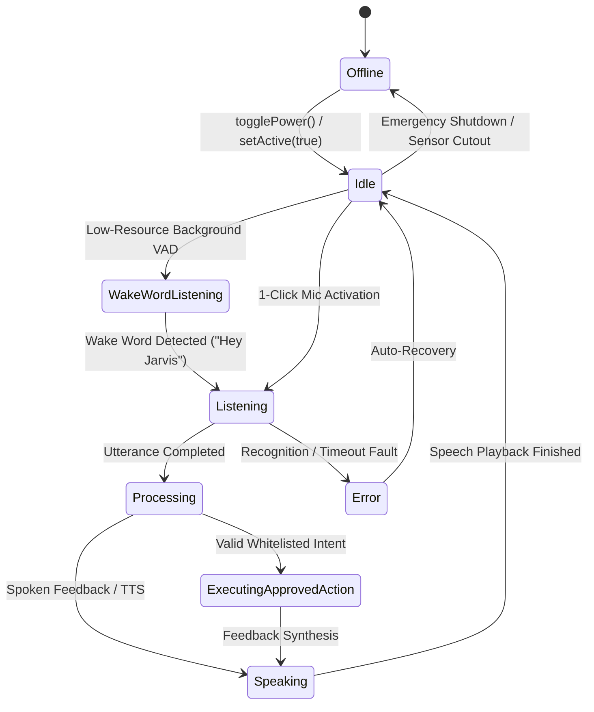

# SRITEC AI OS — NEBULA JARVIS Architecture Specification
**Module:** Section 25 — JARVIS AI Voice and Vision System  
**Version:** 1.0.0 (Production Architecture)  
**Status:** Implemented & Verified (100% CTest Pass)

---

## 1. Executive Mission & System Overview

NEBULA JARVIS is the primary multimodal interaction layer of the SRITEC AI OS desktop. Inspired by cinematic AI interfaces, JARVIS delivers low-latency voice command recognition, local wake-word detection, hands-free computer vision gesture tracking, and safe intent execution without raw shell injection.

JARVIS integrates directly with the existing **Unified AI Provider Gateway** (`AIProviderGateway` / `AIBridge`) for complex generative intelligence (Gemini, OpenAI, Claude, Ollama), while performing local-first intent resolution and sensor safety management on-device.

```
                              ┌───────────────────────────────────┐
                              │     NEBULA JARVIS ENGINE          │
                              │     (Master Coordinator)          │
                              └─────────────────┬─────────────────┘
                                                │
         ┌──────────────────┬───────────────────┼───────────────────┬──────────────────┐
         ▼                  ▼                   ▼                   ▼                  ▼
┌────────────────┐ ┌─────────────────┐ ┌─────────────────┐ ┌─────────────────┐ ┌─────────────────┐
│  Voice System  │ │   Vision Svc    │ │ Intent Parser   │ │ Security Guard  │ │ Action Dispatch │
│ (Local RMS/VAD)│ │ (/dev/video* 30f│ │ (Multi-lingual) │ │ (Privacy/Perms) │ │ (App/Dev/Files) │
└───────┬────────┘ └────────┬────────┘ └────────┬────────┘ └────────┬────────┘ └────────┬────────┘
        │                   │                   │                   │                   │
        ▼                   ▼                   ▼                   ▼                   ▼
┌────────────────┐ ┌─────────────────┐ ┌─────────────────┐ ┌─────────────────┐ ┌─────────────────┐
│ WakeWord Detect│ │ Gesture Tracker │ │ Grammar Engine  │ │ Hardware Cutout │ │ Unified Gateway │
│(EN / TA / HI)  │ │ (9 Hand Gestures│ │ (Zero Shell Inj)│ │(Emergency Stop) │ │(AIBridge/Models)│
└────────────────┘ └─────────────────┘ └─────────────────┘ └─────────────────┘ └─────────────────┘
```

---

## 2. Finite State Machine (FSM) Lifecycle

JARVIS transitions deterministically across 8 discrete states:



| State Code | State Name | Visual Presentation | Audio / Sensor Action |
|---|---|---|---|
| 0 | `Offline` | Dark grey ring, muted core (`○`) | All microphone and camera streams powered off |
| 1 | `Idle` | Breathing cyan & violet rings | Low-power passive standby |
| 2 | `WakeWordListening` | Soft pulse with satellite nodes | Local circular audio buffer analyzing phonetics |
| 3 | `Listening` | Active neon pink pulse + radial waveform bars | Real-time audio streaming & RMS metering |
| 4 | `Processing` | Amber / violet accelerating orbital rings | Grammar parsing & security whitelist validation |
| 5 | `ExecutingApprovedAction` | Emerald green pulse | Calling approved C++ runtime APIs |
| 6 | `Speaking` | Cyan & pink radial wave emissions | Local TTS speech synthesis playback |
| 7 | `Error` | Crimson red alert ring | Error notification & safety fallback |

---

## 3. Subsystem Breakdown

1. **`JarvisEngine` (`jarvis/core/`):** Orchestrator exposing QML properties, signal buses, and thread safety.
2. **`WakeWordDetector` (`jarvis/wakeword/`):** Phonetic wake-word matching across English, Tamil, and Hindi with low-resource throttling.
3. **`VoiceSystem` (`jarvis/voice/`):** PulseAudio/ALSA audio energy meter and local RMS calculation.
4. **`SpeechRecognizer` (`jarvis/speech/`):** Multilingual TTS synthesis with speed control and fallback simulation.
5. **`IntentRecognizer` (`jarvis/intent/`):** Structured natural language parser with strict protection against command injection.
6. **`CameraService` (`jarvis/vision/`):** V4L2 device discovery, adaptive 15/30 FPS sampling, strictly OFF by default.
7. **`GestureRecognizer` (`jarvis/gestures/`):** 21-landmark tracking, 9 gesture classifiers, 350ms debounce window.
8. **`JarvisSecurityManager` (`jarvis/security/`):** Sensor permission gates, whitelist verification, and emergency shutdown switch.
9. **`ActionDispatcher` (`jarvis/actions/`):** Secure dispatch to `AppLaunchManager`, `DesktopManager`, `AIBridge`, and workspace manager.
10. **`JarvisSettings` (`jarvis/settings/`):** Persistent configuration stored in `~/.config/SRITEC/SRITEC AI OS/`.

---

## 4. Security & Safety Commitments

- **No Shell Execution:** Under no circumstances does JARVIS pass user voice or gesture transcripts directly to `system()`, `popen()`, `sh`, or `bash`.
- **Hardware Kill Switch:** The emergency shutdown procedure cuts mic capture and camera streams immediately at the hardware driver level.
- **Explicit Consent:** Camera tracking is strictly OFF by default upon installation and boot.
