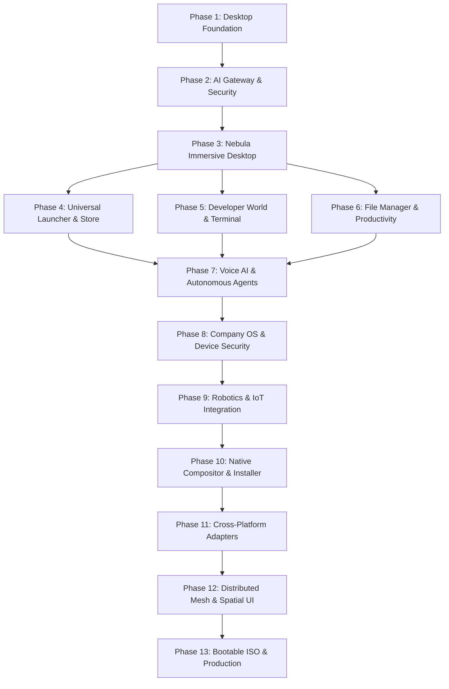

# SRITEC AI OS — Master Engineering Roadmap

> **Document:** `docs/MASTER_ROADMAP.md`  
> **Horizon:** 13 Dependency-Aware Phases  
> **Status:** Phase 1 & 2 Completed; Phase 3 (Nebula Immersive Desktop) In Progress  

---

## 1. Roadmap Overview & Dependency Graph

---

## 2. Phase Breakdown & Deliverables

### Phase 1: Desktop Foundation (COMPLETED)
- [x] Monorepo folder hierarchy (`core/`, `ai/`, `shell/`, `tests/`, `docs/`, `scripts/`).
- [x] Standalone Qt 6 / QML window on existing Ubuntu Wayland session.
- [x] Initial NEBULA dark futuristic theme (`SRITECTheme`).
- [x] Whitelist-first terminal command safety classifier.
- [x] C++20 `std::jthread` Mock AI streaming provider.
- [x] Automated unit test suite (`test_core`, `test_ai_safety`).

### Phase 2: Unified AI Provider Gateway (COMPLETED)
- [x] **Phase 2.1 Gateway:** Unified abstract provider interface (`AIProvider`) with pluggable transport (`ITransport`, `QtNetworkTransport`, `MockHttpTransport`).
- [x] Multi-provider support: Google Gemini (SSE), OpenAI (SSE), Anthropic Claude (SSE), Local Ollama (REST ndjson), and Mock AI (Local).
- [x] Provider selection and model switching exposed to QML via `globalAIBridge`.
- [x] Multi-turn conversation context retention.
- [x] **Phase 2.2 Security & Validation:**
  - Automated regex and exact-match secret redaction (`Logger::sanitize`, `KeyStore::redact`).
  - Volatile memory cleansing (`KeyStore::secureCleanse`).
  - Strict HTTPS TLS 1.2/1.3 verification with error mapping.
  - Zero API key exposure to QML (boolean `hasApiKey` only).
  - Standalone safe smoke runner (`scripts/test-live-providers.sh`) with opt-in network authorization.
  - New automated test suite: `SecurityAndResilienceTest` (8 test cases, 100% passing).

### Phase 3: Nebula Immersive Desktop (CURRENT FOCUS)
- [ ] **Milestone 3.1: Immersive Home Screen & Canvas:**
  - Full-screen responsive desktop surface with toggleable maximize/fullscreen.
  - Interactive procedural neural particle/wave background in QML Canvas.
  - Performance modes (Ultra, High, Balanced, Low, Reduced Motion).
  - Cursor-reactive particle trails and interactive lighting.
  - Floating application dock with glassmorphism, tooltips, and bouncy hover states.
  - Universal search and command bar ("Ask anything. Automate anything.").
  - Holographic AI assistant presence / avatar.
  - System telemetry widgets (Clock, Calendar, CPU, RAM, Disk, Network).
  - Wallpaper customization engine (dynamic procedural, static image, customizable).
  - Real application launcher bridge (`sritec::platform::AppLauncher`) launching installed host tools safely.

### Phase 4: Universal Launcher & Application Store
- [ ] Category-driven application marketplace (Browsers, AI, DevTools, Utilities).
- [ ] Package adapters for APT, Flatpak, Snap, and verified AppImages.
- [ ] Publisher verification, signed metadata, and application inventory.

### Phase 5: Developer World & Smart Terminal Center
- [ ] Multi-tab terminal with split-pane support and shell auto-detection (Bash, Zsh, Fish).
- [ ] Integrated developer workspace with Git branch monitoring, commit visualizer, and Docker telemetry.
- [ ] Enforced AI terminal guardrails with user-confirmation prompts for mutating commands.

### Phase 6: File Manager & Data World
- [ ] Grid and list holographic file browser with thumbnails and metadata.
- [ ] AI semantic search ("find yesterday's report", "summarize code file").
- [ ] Safe drag-and-drop, delete confirmations, and archive management.

### Phase 7: Voice AI & Autonomous Agent Framework
- [ ] Speech-to-text (STT) and text-to-speech (TTS) pipeline.
- [ ] Scoped autonomous agent registry with strict permission boundaries.
- [ ] Human-in-the-loop task scheduler with step-by-step approval and cancellation.

### Phase 8: Company Administration & Device Security
- [ ] Role-based access control (Super Admin, Manager, Developer, Employee).
- [ ] Centralized website restriction engine (filtering YouTube, Instagram, distractors on managed browsers).
- [ ] Device enrollment and signed policy synchronization.

### Phase 9: Robotics & IoT Ecosystem
- [ ] Device abstraction layer for sensors, cameras, and robotics controllers (MQTT, ROS 2, WebSockets).
- [ ] Real-time telemetry dashboard.
- [ ] Mandatory physical safety limits, emergency stop protocol, and simulation validation.

### Phase 10: Advanced OS Integration & Native Installer
- [ ] Systemd user services and D-Bus IPC daemon.
- [ ] Polkit privilege escalation integration.
- [ ] Graphical system installation engine.

### Phase 11: Cross-Platform Adapters (Windows & macOS)
- [ ] Native windowing, notification, and credential store abstractions for Windows and macOS.

### Phase 12: Distributed Mesh & Spatial Interfaces
- [ ] Multi-device peer-to-peer secure sync.
- [ ] Spatial gestures, pen, and touch multimodal inputs.

### Phase 13: Bootable ISO & Production Release
- [ ] Debian/Ubuntu live-build ISO generation with custom UEFI/SecureBoot and Plymouth boot animation.
